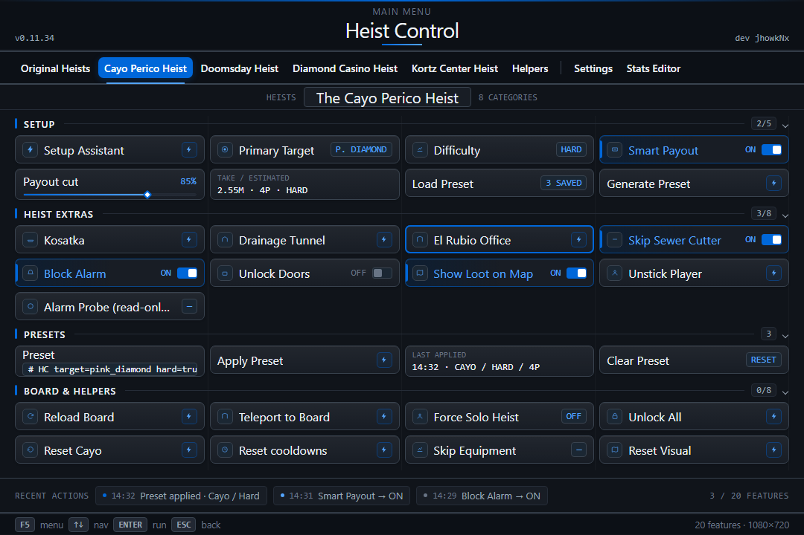

# Heist Control — Yari Edition

**Every heist in GTA V Enhanced. One window.**

Setups, payouts, cuts, helpers and minigame skips for the five classic heists, Cayo Perico, Doomsday, the Diamond Casino and the Kortz Center.

**This is live.** Free access is open: no key, no invite, no waiting list.

**Community:** downloads, support and announcements live in the [Discord](https://discord.gg/6uXdZfdG9Q).



## What is this?

Heist Control puts every heist board in the game into one menu. Instead of digging through setup screens and guessing at multipliers, you pick what you want, set the take, and go.

Pick your heist, pick your setup, set the money, flip on what you need.

It runs on the Yari menu, **version 2.0 or newer** (GTA V Enhanced 1.73).

## Requirements

| | |
|---|---|
| **Game** | GTA V Enhanced (1.73) |
| **Menu** | Yari 2.0 or newer, with Lua scripts enabled |
| **System** | Windows 10 or 11, 64-bit |
| **Connection** | Required — the launcher downloads and checks the script on boot |
| **Account** | None for Free. A license key for PRO |

The launcher is the only file you install. The script is downloaded and kept up to date for you.

> **Current requirement: `natives.lua`.** Some functions need the Yari `natives.lua` file next to the launcher to work correctly. Put it in the same `lua` folder as `JK-Launcher.luac`. This requirement will be removed in a future release, so the script will no longer depend on `natives.lua`.

## Install

### 1. Get the launcher

Download **`JK-Launcher.luac`** from the official Heist Control release post. It's the only file you install by hand.

### 2. Put it in the Yari Lua folder

```
Documents\yari\Grand Theft Auto V\lua\
```

That's the same folder as your other Yari Lua scripts. Keep the name **`JK-Launcher.luac`**.

If you use functions that depend on `natives.lua`, copy `natives.lua` into this same folder, next to `JK-Launcher.luac`.

### 3. Remove any older Heist Control install

If you have an old Heist Control copy in that folder, take it out first. Two copies running at once fight over the menu.

### 4. Start the game and inject Yari

The launcher opens on its own. If it doesn't, check Yari's script list and make sure the launcher is enabled.

### 5. Click **Play FREE edition**

The launcher home shows one product with two cards: **FREE** and **PRO**.

Click **Play FREE edition**. It sets up once — no key, no email — downloads the current build and loads it. The card changes to **Ready to play**.

### 6. Press **Continue to game**

The launcher hides and Heist Control is running.

### 7. Press **`-`**

That's the menu key. You can change it in **Settings → UI → Menu key**.

## Starting a heist preset

Presets write to the heist board, so you have to be **in front of the heist board, inside it**, for them to work correctly.

1. Go to the heist board in GTA Online and stand in front of it, inside the board.
2. Open the Heist Control menu with `-`.
3. Pick the heist tab and the preset you want (Cayo Perico, Doomsday, Diamond Casino, Kortz Center or the apartment heists).
4. Apply the preset while you are still at the board.
5. Wait for the board to redraw before you walk away or start the heist.

If a preset does nothing, check that you are at the board and try again. Presets applied from outside the board may not take effect.

## Controls

| Key | Action |
|---|---|
| `-` | Open / close the menu |
| Arrow keys / numpad | Move around |
| Enter / numpad 5 | Select or apply |
| Backspace | Back one level |
| Esc | Close the menu |
| Mouse | Click and scroll |
| `F8` | Hide / show the launcher |
| `F9` | Shut the launcher down cleanly |

Press `F9` before you disable the script in Yari. That's the safe exit.

## Updates

**The script** updates by itself. Every time you launch, the launcher loads the current build for your edition. There's no file to replace.

**The launcher** updates itself too. When it asks for an update, close the game, replace the launcher file, and start again.

## Features

Eight tabs: one per heist, plus Helpers, Stats Editor and Settings. Two extra pages open from the Cayo tab because they're setup assistants.

### Original Heists

Fleeca, Prison Break, Humane Labs, Series A and Pacific Standard.

- **Finale Presets** — jump straight to the finale you want.
- **Smart Payout (live cap)** — sets your cut for the biggest payout the game will pay.
- **Friends Helper (3M each)** — gives everyone the same cut, up to $3M each.
- **Cut Limit Bypass** — unlocks the cut slider beyond the normal limit.
- **Mastermind Bonus** — fills the challenge progress for the five classics.
- **Complete Heist (stat)** — marks the heist as finished on the board.
- **Unlock Everything** — unlocks all classic heist awards, setups and cutscenes.
- **Repair Planning Board** — fixes a board that opens empty or a launch that hangs.
- **Instant VLSI Hack**, **Instant Drill**, **Instant BruteForce** — skip those minigames. BruteForce is still experimental.

### Cayo Perico

- **Edit your heist** — the full setup in one page: target, difficulty, players, cuts and loot.
- **Preset Creator** — builds a whole preset step by step and saves it as text.
- **Reload Cayo board** — redraws the board with the values you just set.
- **Reset Cayo heist** — puts the board back to default.
- **Ultra / Quick presets** — one click for a $2.55M-per-player run, with or without gear.
- **Teleport** — Kosatka, drainage tunnels, main and secondary targets, office, escape points.
- **Call Kosatka** — brings the submarine to you.
- **Fast loot** and **Fast loot speed** — shorter pickup animations.
- **Get Nearby Pickups** — brings the loot around you to your feet.
- **Show Loot on Map** — marks every loot spot.
- **Minigame skips** — fingerprint, VoltLab, plasma cutter, sewer grate, locked doors, equipment, plus a player unstick.
- **Remove Cayo cooldown** — opens the board again without waiting.
- **Block Alarm** — silences the alarm and stops guards reacting to it.
- **Alarm probe** — reads the alarm state and logs it, changing nothing.

### Doomsday

- **Presets** — Act I, Act II and Act III, plus the mastermind bonus.
- **Instant hacks** — server nodes, beam puzzle and SAM turrets.
- **Instant Finish** — closes the finale you're in.
- **Doomsday mode** — stops the apartment finish from firing by mistake.
- **Max payout (2.4M)** — every seat at the $2.4M ceiling.
- **Live readout** — shows what the board is actually paying.
- **Complete all Preparations**, **Unlock all Heists**, **Unlock all Awards**, **Reset**, **Board state log**.

### Diamond Casino

- **Six presets** — Silent & Sneaky, BigCon or Aggressive, with Diamond or Gold.
- **Custom heist** — hard mode, entrance, exit, disguises, buyer.
- **Reload Board** and **Force Ready** — redraw the board and mark the crew ready.
- **Target payout** — $3.0M to $5.0M per member, default $3.6M.
- **Smart Payout** — same cut for all four seats, solved from the real take.
- **Reset Casino Heist** — back to a clean board.

### Kortz Center

- **Preset** — any of the 27 paintings, difficulty, entrance and weak guards.
- **Planning board** — reload, unlock all preps, unlock the hidden extras.
- **Minigame skips** — skip all, fingerprint, vault nodes, access code, data crack, glass cutting.
- **Take targets** — grab the primary or secondary loot.
- **No body alarm** — guards don't investigate bodies.
- **No cameras** — removes the security cameras.
- **Laser options** — easy, hard, or no damage.
- **Open all doors**.
- **Solo secondary targets** — loot that normally needs two players.
- **Guard probe** — logs the guard state for troubleshooting.
- **Instant finish** — when you're at the finale.
- **Cut one case** — pick a single display case instead of all five.

### Helpers

- **Leave GTA Online** — back to story mode.
- **Force Ready** — marks the job ready.
- **Auto-leave island** — leaves Cayo when the heist ends.
- **Force Solo Heist** — starts the classic apartment heists solo. **Apartment only — Cayo is excluded.** Turn it off after the heist.
- **Skip Checkpoint** — jumps a stuck setup forward.
- **Team Lives (111)** — sets the team lives for the job.
- **Instant Finish** — closes Cayo or apartment heists for you.
- **Teleport** — to your apartment or the planning board.
- **Shoot all peds** / **Shoot hostiles only**.
- **Diagnostics** — checks a stat and shows the model you're aiming at.

### Stats Editor

A live list of the stats and values you care about. You choose the list in a small text file; the menu shows each value live and lets you edit it.

- **Reload from .ini** — rebuilds the list after you edit the file.
- **Save example .ini** — writes a commented template you can copy.
- **Live read** — refreshes values while the page is open.
- **Notify changes** — tells you when a value moves.
- **Refresh every** — from 0.25 s to 60 s.

### Settings

- **UI** — scale, text size, hints, dark theme, accent color, lock window, menu key, collapse groups, restore defaults.
- **Texts** — separate sizes for titles, sub-texts and the footer.
- **Notifications** — toasts on/off, size, duration, stack, position and a test toast.

Your menu settings are saved, so they survive restarts.

## The money

### Smart Payout

Fixed percentages get heist payouts wrong: the game multiplies the take by difficulty, by the current event, then takes fees and crew cuts out of it. Change the target or bring a fourth player and the number misses.

Smart Payout reads the live board and solves for the cut instead, so the money lands on the cap the game is paying right now.

- **Apartment heists** — your slot at the $3M cap, with Friends Helper to bring the crew along.
- **Doomsday** — every seat at $2.4M.
- **Diamond Casino** — one equal cut for all four seats, for the target you choose.
- **Cayo Perico** — $2.55M each, calculated from the real target price and difficulty.
- **Kortz Center** — a modded host payout, still being tuned.

Prefer a clean run? Turn it off and the game pays out naturally.

### Friends Helper

Gives every player the same cut and closes the board at 100, so the split always adds up. With two or three players the empty seat takes the remainder; with four, the host covers it. On the apartment heists that's up to $3M each, however many friends show up.

And on the apartment heists, the mastermind bonus is the one thing that pays above that cap.

### Payout map

| Heist | Target |
|---|---|
| **Original Heists** | up to **$3M per player**, plus mastermind bonuses |
| **Cayo Perico** | **$2.55M per player** |
| **Doomsday** | up to **$2.4M per player** |
| **Diamond Casino** | equal cut on all four seats, **$3.0M–$5.0M** each |
| **Kortz Center** | modded host payout, still being tuned |

## Free vs PRO

| | Free | PRO |
|---|---|---|
| **Price** | Free | Paid license key |
| **Script** | Full Heist Control | Full Heist Control |
| **New features** | Arrive later | **First** — usually hours or days earlier |
| **Key required** | No | Yes |
| **Development** | — | Helps fund new scripts |

PRO gets new features first: they usually reach PRO hours or days before they land on Free. It's the same script, just ahead of the line.

PRO also funds the next scripts. If you like what this project does and want more of it, that's what the key pays for.

## Troubleshooting

**The launcher doesn't appear.** Check Yari's script list, and make sure the file is inside the `lua` folder, not a subfolder.

**The menu doesn't open.** The launcher must say **Ready to play** and you must have pressed **Continue to game**. Then press `-`.

**I see two menus.** You still have an old Heist Control copy in the Lua folder. Remove it.

**"Update required."** Download the current launcher, close GTA, replace the file, start again.

**"Free access is unavailable."** Free access is closed on the server side. Try again later.

**A feature does nothing.** Most actions need you to be in the right place: online, on that board, or inside the heist. Get there and press again.

**Cuts don't stick.** The game rewrites the board. Use Smart Payout (or **Hold cuts** in the Preset Creator) so the cut keeps being written.

**A minigame skip does nothing.** Those only work while that specific finale or prep is running.

**I replaced the launcher and nothing changed.** Close and reopen GTA.

**The game crashed when I disabled the script.** Press `F9` first, then disable it.

## Known limits

- **Yari 2.0+ and Enhanced 1.73 only.**
- **Online required.** No connection, no script.
- **Cayo with 3–4 players needs hard mode** to reach $2.55M each. Normal mode caps the whole take lower, and no cut fixes that.
- **Force Solo Heist is apartment-only.** Cayo is excluded on purpose.
- **The Stats Editor only shows what you list.** It's a monitor and editor, not a browser.
- **The look will keep changing.** The UI is the part most likely to move between builds.

## Not our first rodeo

Heist Control didn't start here. Before Yari, this same team built Heist Control for 2take1 (V2/V3). We've been making heist tools since those days, so a lot of what you see here is experience carried over, not guesswork.

That said, we're not above getting it wrong — which is why nothing reaches Free until it has been run in-game. Every build you get has already been played.

## Licensing

The Free edition is free: no key, no account, no expiry.

PRO is a paid license that gets new features first, usually hours or days early, and funds the next scripts. Keys are tied to a device, and the launcher handles that for you.

Both editions run the same script, just at different times.

---

Questions, bug reports, build announcements: open an issue here. When a heist breaks after a game update, the build number and a short description get it fixed faster.
