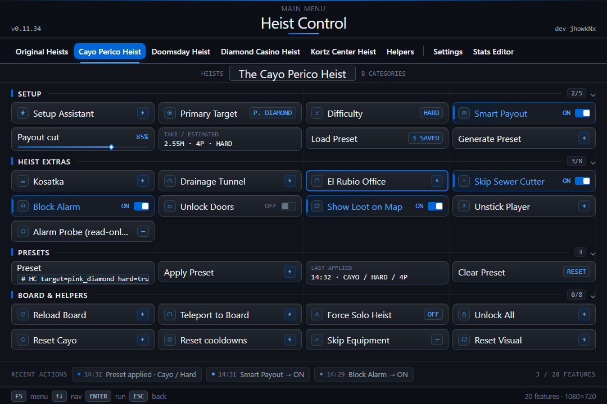

# Heist Control — Yari Edition

Every heist. One script. No headache.

> **This is a preview, not a release.** The script is private and still in development — no download, no release date. But everything you see here already works and has been tested. What's left is small bugs and final polish, then I start putting it in front of people.

**Exclusive to Yari 2.0 and up.** If you're on anything older than 2.0, this won't run — update Yari first. Not compatible with older versions.

## What is this?

Heist Control is a heist script for GTA V Enhanced. It takes all the setup stuff — presets, payouts, cuts, helpers — and puts it in one window with a tab per heist. Pick your setup, set the take, flip on what you need, and get on with it.

If you've ever sat at a heist board flipping through options trying to remember what does what, this is for you.

It runs on the Yari Menu, **version 2.0 or newer** (GTA V Enhanced 1.73).

## Not our first rodeo

If the name rings a bell, here's why: this is the same team that built Heist Control for 2take1 (V2/V3). We've been making heist tools since those days, so a lot of what you see here is experience carried over, not guesswork.

That said, we're not above getting it wrong — which is why nothing ships until it's proven in-game. Every feature you see here has been run and tested before it ever reaches you.

## The heists

**Original Heists.** The five classics — Fleeca, Prison Break, Humane Labs, Series A and Pacific Standard. Finale presets so you skip the setup fiddling, a cut editor that doesn't fight you, and board helpers that get the job ready.

**Cayo Perico.** The big one. A setup assistant walks you in, you pick the primary target and difficulty, and Smart Payout handles the money. Save your favorite setups as presets, run it solo, and skip the prep you're tired of grinding.

**Doomsday.** Presets for each act, the payout math done for you, and helpers for the parts everyone hates — the IAA setup, the beam, SAM sites, the finale. Prep unlocks and awards too.

**Diamond Casino.** Six approaches ready to go: Diamond or Gold, crossed with Silent, Big Con or Aggressive. Custom board options, reload and ready when you need them, and Smart Payout so the whole crew gets a fair cut.

**Kortz Center.** The newest one. Pick your target, difficulty and entry, reload the board, and let the prep helpers and minigame skips save you the repetition. Plus a straight modded payout for the host.

Three utility tabs on top: **Helpers**, **Settings**, and a live **Stats Editor**.

## Smart Payout: the biggest cut, for everyone

This is the headline feature. Smart Payout runs **modded payouts** — but it doesn't just slap a fixed percentage on the board and hope. It reads the live game values (target price, difficulty, the current event multipliers, the game's fees) and works out the exact cut so the money actually lands.

Why that matters: the payout changes with every choice you make — different target, different difficulty, different approach, different crew size. A fixed cut gets it wrong half the time. Smart Payout recalculates instead, so **no matter what you pick, everyone still lands on the biggest payout the game will hand out.**

It even keeps up during bonus events. Instead of promising a number that looks huge and then gets clipped, it aims at the real cap the game pays right now — event or not — so you get the max that actually sticks.

Per heist, here's what it goes for:

| Heist | The payout |
|---|---|
| **Original Heists** | up to $3M per player, with elite / mastermind bonuses on top |
| **Cayo Perico** | $2.55M for every player in the crew |
| **Doomsday** | up to $2.4M |
| **Diamond Casino** | one equal cut across all four seats —up to $3.6M |
| **Kortz Center** | a modded host payout you choose (to be calculed) |

Set the target, it does the math and writes it before you commit. Prefer to play clean? Flip it off and the game pays out naturally. Your call.

## Friends Helper: nobody gets shorted

Smart Payout's partner in crime. Friends Helper gives **every player the same cut** and closes the board at 100, so the split always adds up.

It also handles the awkward math when your crew isn't full: with 2 or 3 players the empty seat absorbs the leftover, so everyone actually gets paid; with a full 4 the host covers it. On the apartment heists that means up to $3M each, regardless of how many friends show up.

Bottom line: host and friends eat the same. Nobody joins your heist and gets a token cut.

## Where it's at

Honest version: the script is private right now. Everything shown here works and has been tested; what's left is small bugs and final refinements. Once that's done, I'll start sharing it with the public. No release date yet — but this is close.

And don't get too attached to the exact look: the UI can change before launch, and it'll keep evolving after release too. I'll polish it as long as there's something worth improving.

## Getting your hands on it

Not yet — and that's on purpose. There's no public download or installer while I finish the last polish. When it's ready, this repo is where you'll hear about it first, so watch or star it and you'll catch the release the moment it lands.

If you run these heists and want them to be less of a grind, this is being built for you. See you at launch.
